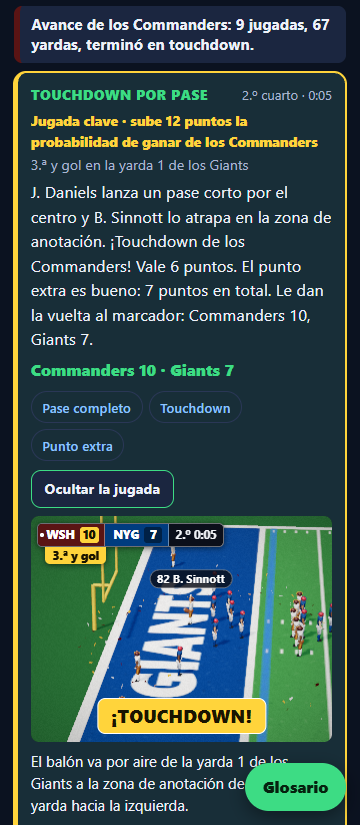
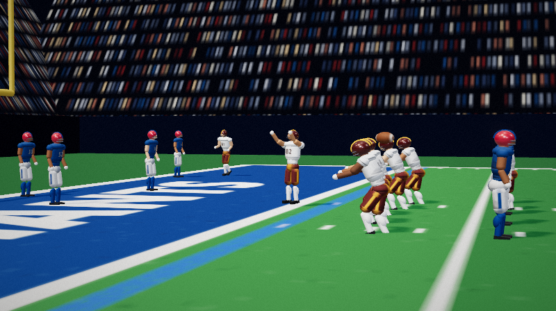
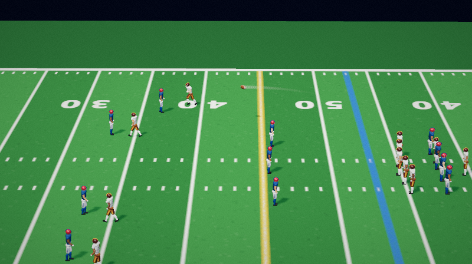
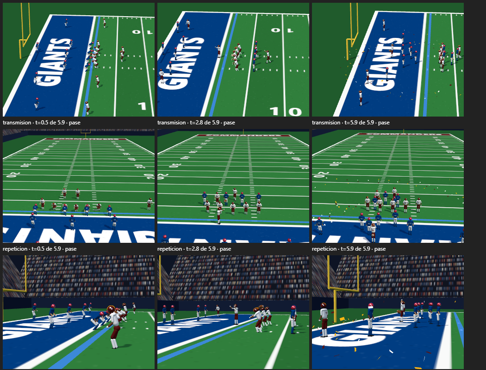
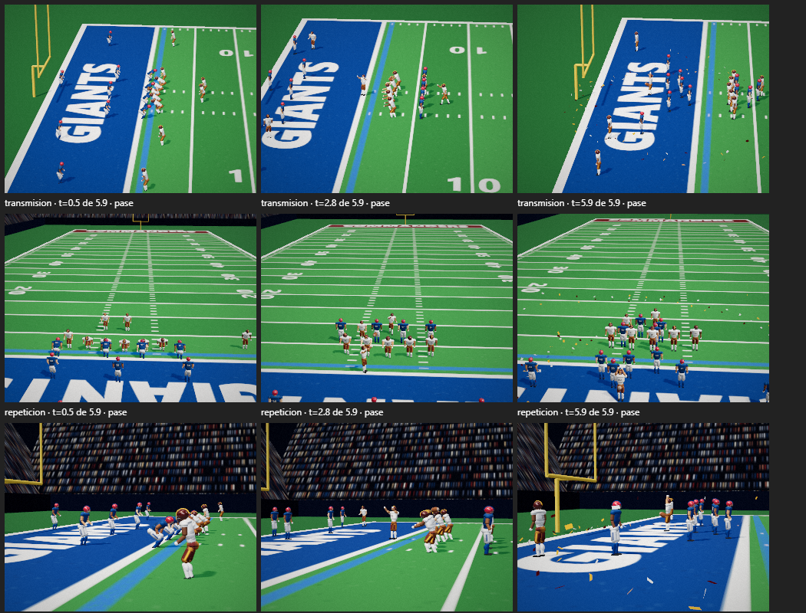

# Primer Down

**La NFL explicada en español mientras la ves.** Abres un partido y cada jugada aparece traducida a lenguaje claro: qué pasó, por qué importa y qué significa cada término. Pensado para quien ve fútbol americano y todavía no entiende qué es un "tercera y 8".

**Sitio publicado:** https://juanerodriguezh-eng.github.io/primer-down/



## Qué hace

- **Jugada por jugada, en español.** Un motor de reglas (sin IA en vivo) explica los 32 tipos de jugada que aparecieron en 137 partidos reales de esta temporada: pases, carreras, penales, despejes, goles de campo, revisiones y cambios de posesión.
- **En vivo y en repetición.** Lee la API pública de ESPN cada 20 segundos durante un partido. Si no hay partido, trae 16 partidos guardados que se reproducen jugada por jugada, como si fueran en vivo.
- **La jugada en 3D, como en la tele.** Cada jugada se puede ver recreada con 22 jugadores, cámara de transmisión, repetición desde el fondo y una cámara a ras de cancha. Lleva marcador de esquina con el cuarto, el reloj y la oportunidad ("3.ª y 7"), las líneas azul y amarilla pintadas sobre el pasto, cortina de repetición, luz de estadio con reflejos en los cascos y estela del balón en los pases largos. Los nombres y los dorsales son los reales; las posiciones son una recreación ilustrada, porque ESPN no entrega dónde está cada jugador (el sitio lo avisa siempre).
- **La Pizarra.** Cinco jugadas clásicas (play action, screen, blitz, Hail Mary y onside kick) paso a paso, con X y O o con jugadores 3D.
- **Glosario** de 76 términos, mini cancha con la situación actual y resumen "Así se ganó el partido" al final.





### Antes y después del último encargo ("que se vea más real")

La misma jugada, en los mismos instantes y con las mismas tres cámaras:





## Cómo está hecho

- Sitio estático: HTML, CSS y módulos de JavaScript sueltos. **Sin build, sin frameworks, sin claves de API y sin costo.** La única librería es Three.js 0.170.0 (licencia MIT) con 11 de sus addons, copiados en `js/vendor/` y cargados solo cuando alguien abre una vista 3D.
- La lógica está separada de la pantalla: el motor de explicaciones (`js/motor.js`), el modelo del partido (`js/modelo.js`), el sondeo en vivo (`js/vivo.js`) y la recreación de jugadas (`js/jugada3d.js`, `js/clasica3d.js`) son funciones puras con pruebas. `js/vista3d.js` solo dibuja.
- Si el dispositivo no tiene WebGL o pide reducir el movimiento, la vista 3D se reemplaza por una pizarra 2D. El sitio no depende del 3D para funcionar.
- **Calidad automática:** la vista 3D mide sus cuadros por segundo; si bajan de unos 40, apaga sola el bloom, el grano y las sombras suaves (`js/calidad.js`). Se puede fijar con `&calidad=alta`, `media` o `baja` en la dirección.
- Sin fotos, logos ni marcas: jugadores, cancha y texturas están dibujados con código. Los colores de cada equipo sí se usan.

## Cómo se construyó con Fable

Todo el código lo escribió Claude Fable trabajando **solo, en turnos cortos programados y sin supervisión**, que se cortaban sin aviso al agotarse el cupo. Para que cada turno pudiera continuar el anterior:

- Un encargo escrito por etapa (`ENCARGO-NOCTURNO.md`, `ENCARGO-2.md`, `ENCARGO-3.md`) y una especificación (`ESPECIFICACION.md`). Fueron 8 turnos en total.
- Una bitácora (`BITACORA.md`) donde Fable anota cada avance verificado, cada decisión que tomó sin consultar, lo que no pudo comprobar y dónde tuvo que corregirse. El turno siguiente empieza leyéndola y verificando lo que encontró a medias antes de seguir.
- Comprobaciones automáticas en vez de "se ve bien": pruebas con `node --test` y un script que abre el sitio en un navegador sin ventana a 360 px. Varias veces esas comprobaciones encontraron errores que a simple vista no se notaban; están contados en la bitácora.

Los encargos, con el resultado de cada uno y sus correcciones honestas, están en `PROMPTS-FABLE.md`.

## Abrirlo en tu computadora

Solo hace falta Node 22 o más reciente (probado con Node 24.19). No se instala nada.

```
npm start
```

Luego abre http://localhost:8080. Para ir directo a una jugada en 3D: http://localhost:8080/partido.html?id=401873052&modo=repeticion&jugada=87&pizarra=3d

## Pruebas

```
npm test
node herramientas/verificar-sitio.mjs
```

- `npm test` corre 154 pruebas del motor, el modelo, el modo en vivo, la pizarra, las recreaciones 3D, los gráficos de TV, la calidad automática y el contraste de colores, con barridos de todas las jugadas de los 16 partidos guardados. Dos pruebas se saltan solas en una copia del repositorio: usan el corpus completo de 137 partidos (25.387 jugadas), que no se publica por su tamaño.
- `verificar-sitio.mjs` necesita Chrome o Edge: abre 28 páginas a 360 px y revisa el contenido, los errores de consola, que nada se desborde, la vista 3D y su respaldo sin WebGL. Lo que depende de ESPN sale como "aviso": ESPN no responde a navegadores sin ventana, así que esa parte hay que mirarla en un navegador normal.

## Lo que falta comprobar

- El modo en vivo está probado con partidos simulados (un partido guardado que avanza solo), no todavía con un partido real en curso.
- La fluidez de la vista 3D en un celular real. Las pruebas automáticas solo ven cuadros congelados: los movimientos nuevos de los jugadores, el temblor de cámara y la cortina de repetición todavía no se han visto en movimiento.

---

Proyecto independiente, sin relación con la NFL, sus equipos ni ESPN. Los datos de los partidos vienen de la API pública de ESPN.
